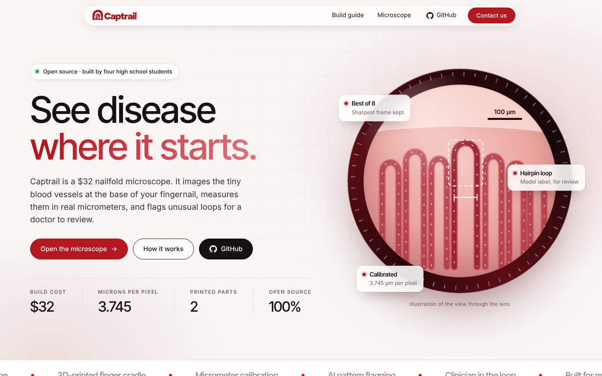
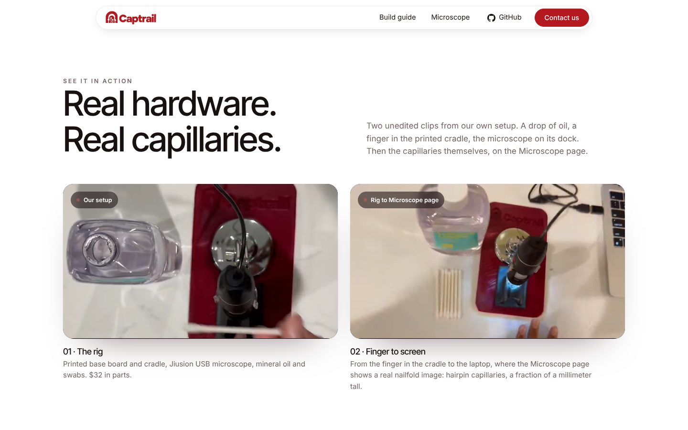
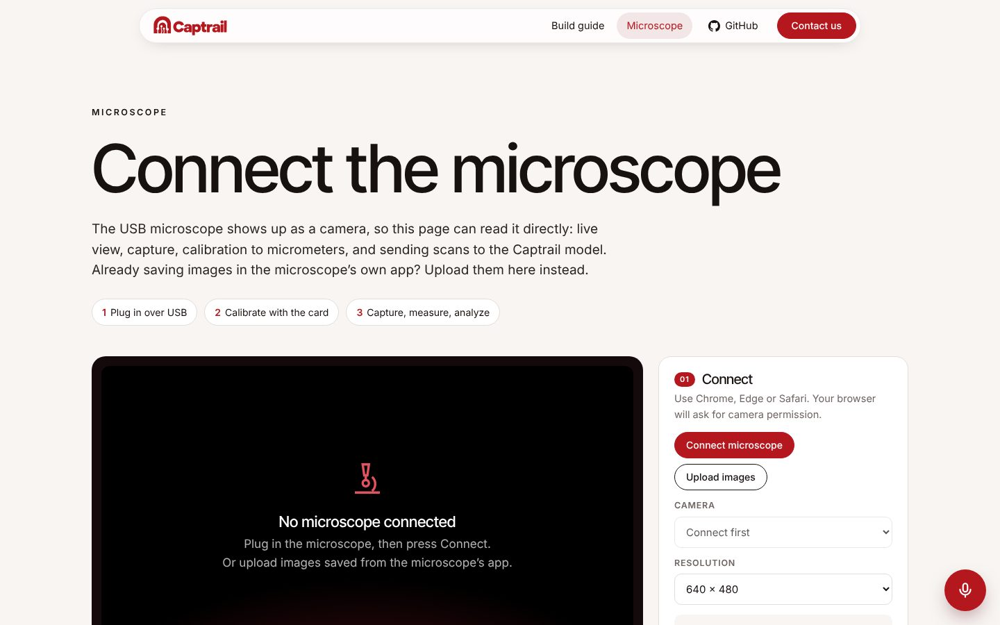
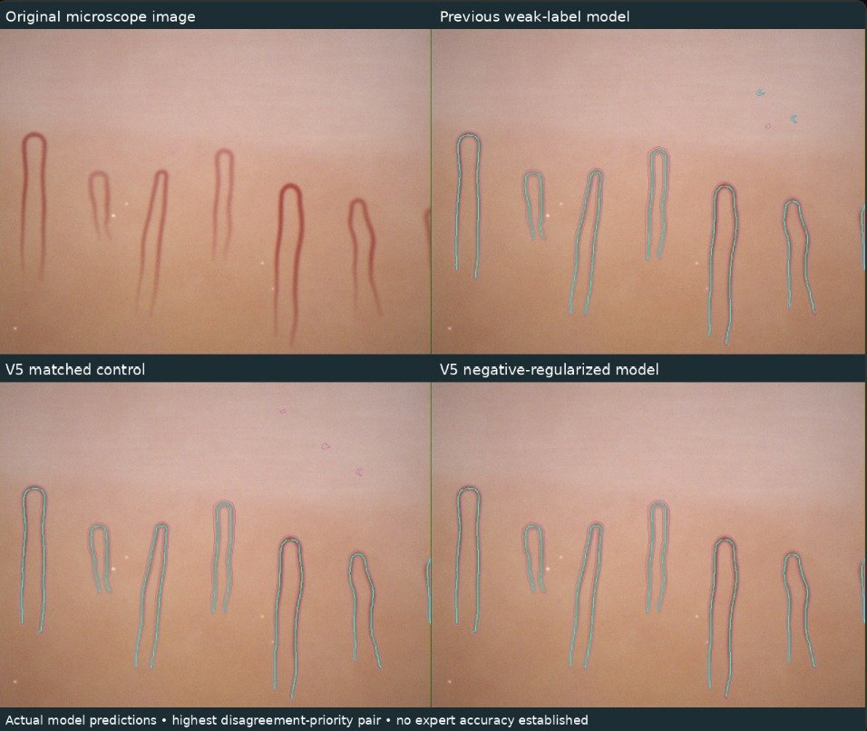

<p align="center">
  <a href="https://captrail-app.vercel.app"></a>
</p>

<p align="center"><b>A $32 nailfold microscope that images the tiny blood vessels at the base of your fingernail,<br>measures them in micrometers, and flags unusual loops for a doctor to review.</b></p>

<p align="center">
  <a href="https://captrail-app.vercel.app"></a>
  <a href="https://captrail-app.vercel.app/scan.html"></a>
  <a href="https://captrail-app.vercel.app/build.html"></a>
</p>

> Research prototype for screening and referral. Not a diagnostic tool, and it does not replace a doctor.

<p align="center"><a href="https://captrail-app.vercel.app"></a></p>

## How it works

1. **Rest a finger** in the 3D-printed cradle. It clicks onto pegs on the base board, so the finger lands in the same spot every time.
2. **Add one drop of mineral oil** to the nailfold to cut glare.
3. **Open the [Microscope page](https://captrail-app.vercel.app/scan.html).** The USB microscope shows up as a camera in the browser. Best of 8 keeps the sharpest frame.
4. **Calibrate once** with the card at nail zoom. Every measurement is then in micrometers.
5. **Measure and flag.** Click across a loop for its width, run the trained loop-shape model, or ask for an AI review. A clinician makes every call.

| Real hardware, real capillaries | The Microscope page |
| --- | --- |
|  |  |

## The AI, measured honestly

Our trained model outlines capillaries and labels their shape. Version 5 adds negative regularization, which penalizes it for marking vessels where there are none.

| False vessel area on 12 test control images (lower is better) | |
| --- | --- |
| Previous V4 model | 12.75% |
| **New V5 model** | **2.62%** |

<p align="center"></p>

These are the team's own tests. No expert accuracy has been established yet, and every label is a suggestion for a person to review.

## At a glance

| | |
| --- | --- |
| Build cost | **$32** (USB microscope, two 3D-printed parts, mineral oil, swabs) |
| Scale at nail zoom | **3.745 µm per pixel** (640 × 480 frame ≈ 2.4 × 1.8 mm) |
| Calibration | Coordinate cross on the calibration card: 0.1 mm per small tick, 1 mm per long line |
| Software | Runs in the browser. Nothing to install |
| AI | Trained loop-shape model (private backend) plus an optional Claude review (`claude-sonnet-5-5`) |
| Who decides | A clinician. Every result is a flag, never a diagnosis |

## What is in this repo

| Path | What it is |
| --- | --- |
| `index.html` | Landing page: real clips, why it matters, how it works, Microscope page walkthrough, AI results, build, results, team, open source |
| `build.html` | Parts list and step-by-step assembly guide |
| `scan.html` | Microscope app: live view, Best of 8, µm calibration, click-to-measure, AI analysis, voice commands |
| `site.css` / `site.js` | Shared styles, header and footer (add header pages in the `PAGES` list in `site.js`) |
| `api/` | Vercel functions: `analyze.js` (Claude review), `voice.js` (voice commands), `ml-bridge.js` (private trained model) |
| `captrail_print_files/` | Finger cradle and base board, `.stl` and `.gcode` |
| `sims/` | Microscope physics simulations, calibration code and tests |
| `tests/` | Automated tests for the model bridge |
| `images/brand/` | Logo, mark, favicon source and social preview image |
| `images/media/` | Clips of the real setup and screen recordings used on the landing page |
| `404.html` | Branded not-found page |

## Calibration

Image the calibration card at the **same zoom and height you use on the nail**, click two marks a known distance apart on the Microscope page, and enter the distance in µm.

```
µm per pixel = known distance in µm / distance in pixels
```

Our setup reads **3.745 µm per pixel** at nail zoom. Recalibrate whenever zoom, height or focus changes.

## Environment variables

Set these in Vercel → Project → Settings → Environment Variables, then redeploy. For local testing, copy `.env.example` to `.env.local` (ignored by git).

| Name | Used by | Needed for |
| --- | --- | --- |
| `ANTHROPIC_API_KEY` | `api/analyze.js`, `api/voice.js` | AI review and voice answers |
| `CAPTRAIL_ML_BACKEND_URL` | `api/ml-bridge.js` | Trained model (optional, https only) |

## Run locally

```bash
npm install
npx vercel dev      # serves the site and the api/ functions, reads .env.local
```

For the static pages only, `npx serve .` works. The microscope page needs `localhost` or `https://` for camera access.

## Deploy

```bash
npx vercel deploy --prod
```

## Team

Four students from four Georgia high schools:
Sujay Godala (Denmark High School) · Smyan Reddy (Lambert High School) · Aryan Senthilkumar (Northview High School) · Ansh Mishra (Alliance Academy for Innovation)

## Credits

Finger rest design adapted from [Attune (dlx-designlab)](https://github.com/dlx-designlab/Attune). Built with NumPy, SciPy, OpenCV, scikit-learn, pandas, PyTorch, FastAPI and the Anthropic SDK.
